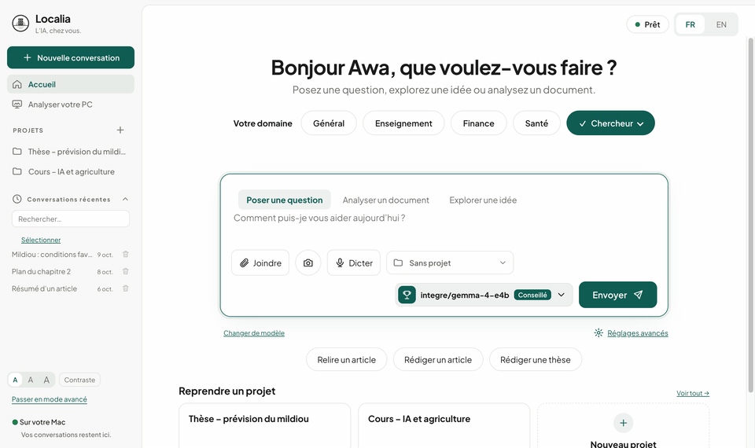
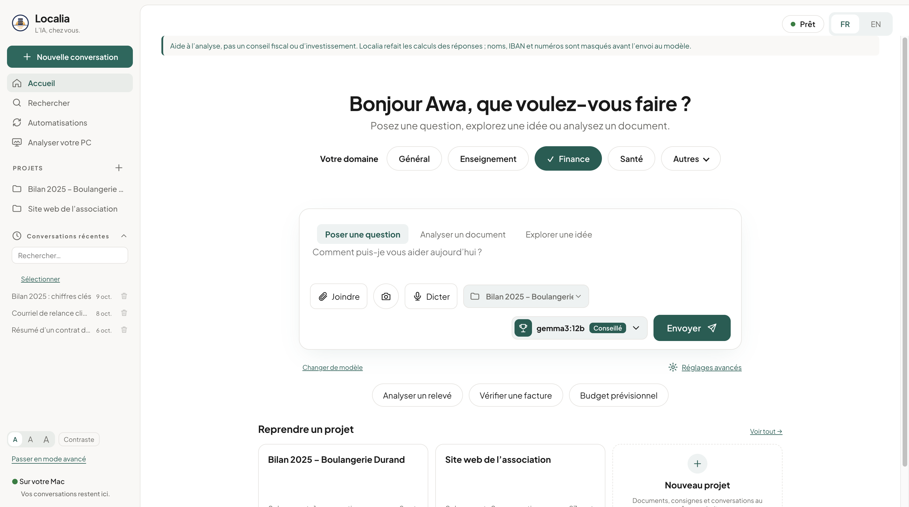
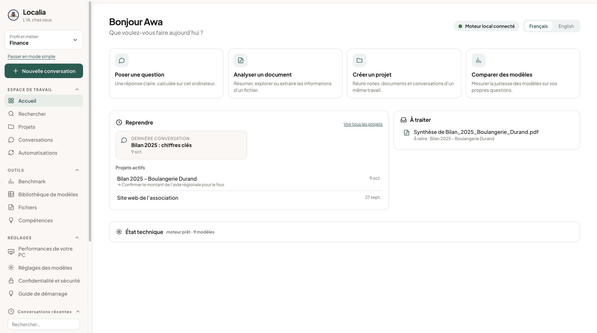
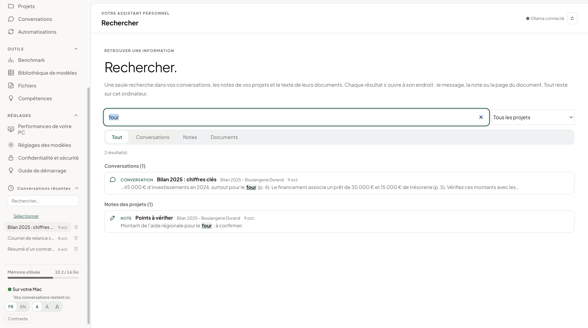
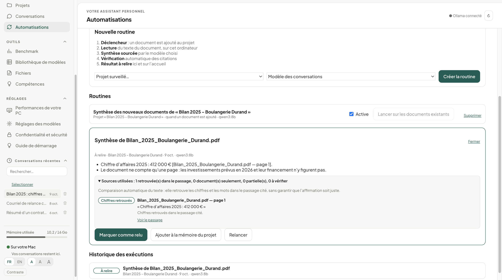

<p align="center"></p>

# Localia

[](https://github.com/diallo68/localia/actions/workflows/tests.yml)

*[English version](README.md)*

Localia est une application de bureau pour macOS, Windows et Linux, pour utiliser des modèles de langage locaux — avec son **moteur intégré** (llama.cpp, modèles téléchargés depuis Hugging Face) ou avec [Ollama](https://ollama.com) — et surtout pour **les comparer de façon mesurable sur vos propres tâches**. Tout reste sur votre machine : aucun modèle cloud, aucune télémétrie.

<p align="center"><a href="https://github.com/diallo68/Localia/releases/latest"><b>⬇ Télécharger Localia</b></a> — macOS (puce Apple et Intel), Windows, Linux · gratuit et libre</p>

<p align="center"></p>

| Mode simple | Mode avancé : accueil |
|---|---|
|  |  |
| **Recherche commune** | **Automatisations** |
|  |  |
| **Conversation** | **Benchmark** |
|  |  |
| **Comparaison d'une série de questions** | **Graphiques du Benchmark** |
|  |  |

*Captures réalisées avec des données de démonstration, pas avec de vrais résultats.*

## Fonctionnalités

- **Conversations** avec des modèles locaux : réponses progressives mises en forme (le HTML produit par le modèle n'est jamais exécuté), historique conservé, conversations renommables et supprimables.
- **Questions sur un PDF** : texte extrait localement (PDF.js) ; pour les documents longs, des extraits pertinents sont sélectionnés et les pages transmises au modèle sont affichées.
- **Vérifications automatiques**, sans modèle, sous chaque réponse : calculs refaits, références de pages impossibles, citations introuvables dans le document, nombres absents ; les PDF contenant une consigne adressée à une IA sont signalés dès l'import.
- **Assistant de recherche** : un menu Tâche choisit le modèle conseillé par votre Benchmark et ajoute une consigne adaptée ; la mémoire par projet envoie vos propres notes au modèle comme contexte.
- **Projets** : documents (PDF même scannés, Word, Excel, PowerPoint, CSV, textes, photos) et notes ; en tête de chaque projet, la prochaine étape que vous notez, ses conversations, les résultats conservés et les derniers documents, lisibles page par page. Dans une conversation de projet, chaque source citée est comparée au passage du document, avec un libellé qui dit ce qui a été retrouvé (chiffres, mots-clés ou seulement le document) : une correspondance de texte, pas une garantie de justesse.
- **Mémoire relue** : une réponse n’entre dans la mémoire d’un projet qu’après relecture, avec sa provenance (conversation, question, modèle, date) ; les décisions que vous écrivez (« on retient… ») sont proposées comme notes, à enregistrer, corriger ou ignorer.
- **Recherche commune** (⌘K) : conversations, notes et texte des documents des projets, filtrable par projet et par type ; chaque résultat s’ouvre à son endroit (message, note, page du document).
- **Automatisations** : une routine surveille un projet ; chaque document ajouté est lu, résumé avec ses sources par le modèle choisi, ses citations vérifiées, puis proposé à la relecture. Étape réelle affichée, arrêt et suspension ; vos conversations passent avant ; un traitement interrompu reprend au démarrage suivant.
- **Accueil** du mode avancé : reprendre (dernière conversation, projets actifs et leur prochaine étape), à traiter (résultats à relire, erreurs, nouveaux articles de la veille, départ programmé manqué), activité en cours, état technique replié.
- **Fichiers, avec votre accord** : le modèle propose un plan (classer, renommer, créer des dossiers ou une note) dans un dossier que vous avez autorisé ; Localia vérifie chaque action, vous cochez ce qui doit être appliqué ; rien n'est écrasé ni supprimé définitivement, chaque opération peut être annulée.
- **Chiffrement facultatif** de toutes les données de Localia sur le disque (AES-256-GCM, clé dans le trousseau de macOS, clé de secours).
- **Sauvegarde et restauration** : toutes les données dans un seul fichier `.localia`, chiffré par une phrase de passe (AES-256-GCM, scrypt), indépendant du trousseau ; empreinte de chaque élément vérifiée ; avant une restauration, les données actuelles sont copiées dans un dossier « avant-restauration ».
- **Zotero** (en local, lecture seule) : recherche dans votre bibliothèque, comparaison des références d'un article avec elle, questions sur le PDF d'un élément.
- **Veille et séries programmées** : nouveaux articles sur vos sujets (OpenAlex, facultatif), séries du Benchmark lancées à l'heure choisie, Mac maintenu éveillé ; un départ programmé est conservé si Localia se ferme, et signalé comme manqué s'il est passé (jamais lancé à votre insu).
- **Compétences** : consignes réutilisables en Markdown, choisies dans le menu Tâche ou appelées par `/nom` en début de message ; parcours pas à pas pour les données brutes, l'article, la thèse et le développement d'une application.
- **Fichiers de données** : consignes, code ou CSV joints à une conversation ; les tableaux sont résumés (colonnes, types, manquants, bornes) au lieu d'être envoyés en entier ; vous exécutez vous-même le code produit.
- **Bibliographie** : citations d'auteurs (« Nom [n] ») comparées hors ligne à la liste de références de l'article ; en option (désactivée par défaut, seule fonction qui utilise Internet), existence des références vérifiée avec Crossref et recherche d'articles avec OpenAlex.
- **Réglages par modèle** : température, contexte, longueur maximale de réponse, top P, top K, pénalité de répétition, graine, threads processeur, maintien en mémoire, réflexion, consigne permanente. Un champ vide garde la valeur prévue par le Modelfile du modèle.
- **Comparaison** : une question ou une série de questions (avec un PDF facultatif) envoyée à plusieurs modèles ; chaque modèle traite toutes les questions puis il est déchargé. Une série peut être répétée de 1 à 5 fois, mise en pause et reprise.
- **Benchmark**, conçu pour des résultats publiables :
  - par modèle : précision, part « correct ou partiel », taux d'invention, note moyenne, temps moyen et médian, temps de chargement, vitesses de génération et de lecture (mesures d'Ollama), en moyenne ± écart-type sur les répétitions ;
  - précision par catégorie de question (carte de chaleur), stabilité entre répétitions, accord entre correcteurs (kappa de Cohen) ;
  - notation à l'aveugle (ordre aléatoire, nom du modèle masqué), import des notes d'autres correcteurs (CSV) ;
  - exports : données brutes (CSV, JSON), graphiques (SVG autonomes), conditions de l'expérience (Markdown : machine, version d'Ollama, empreinte et quantification des modèles, réglages utilisés, messages exacts envoyés).

## Premiers pas

Au premier lancement, Localia ouvre un **guide de démarrage** : télécharger le modèle conseillé pour la mémoire de l'ordinateur (moteur intégré, rien d'autre à installer), poser une première question. Ollama est facultatif. Il se rouvre depuis la colonne de gauche.

## Prérequis

- macOS sur Apple Silicon ou Intel, Windows 10/11 (64 bits), ou Linux (64 bits ; AppImage ou .deb) ;
- facultatif : [Ollama](https://ollama.com) (Localia le cherche aux emplacements habituels : `/usr/local/bin`, `/opt/homebrew/bin` ou l'application Ollama sur macOS, `%LOCALAPPDATA%\Programs\Ollama` sous Windows ; `OLLAMA_PATH` l'emporte) ;
- pour construire depuis le code : [Node.js](https://nodejs.org) 20 ou plus récent.

## Lancer depuis le code

```sh
npm install
npm start
```

Construire l'application pour un usage local :

```sh
npm run package            # Mac Intel         → dist/mac/Localia.app
npm run package:mac-arm64  # Mac Apple Silicon → dist/mac-arm64/Localia.app
npm run package:win        # Windows           → dist/win-unpacked/Localia.exe
npm run package:linux      # Linux             → dist/linux-unpacked/localia
npm run dist:linux         # AppImage et .deb
npm run dist:mac           # .dmg et .zip pour les deux processeurs Mac
npm run dist:win           # installateur Windows et .zip
```

Les versions Mac sont signées *ad hoc* (obligatoire sur Apple Silicon), pas avec un certificat de développeur Apple.

## Tests

```sh
npm test                 # tests unitaires (sans Electron ni Ollama)
npm run test:features    # application de bureau, Ollama simulé
npm run test:pdf         # application de bureau, import réel d'un PDF, réponses et services simulés
npm run test:workspace   # recherche, projets, mémoire, routines, sauvegarde ; Ollama simulé
npm run test:encryption  # chiffrement des données, coffre de clés simulé
npm run test:engine      # moteur intégré réel (llama.cpp) avec un modèle de test de 105 Mo (téléchargé une fois)
npm run test:desktop     # application de bureau, nécessite Ollama actif avec un modèle
```

Deux mesures reproductibles complètent les tests :

```sh
node scripts/mesure-recherche.cjs        # choix des passages des documents (docs/MESURE-RECHERCHE.md)
node scripts/audit-accessibilite.cjs     # contrastes, clavier, zoom 200 %, cibles (docs/ACCESSIBILITE.md)
```

Le workflow GitHub lance ces tests et construit l'application sur macOS Apple Silicon, macOS Intel et Windows.

## Format des séries de questions

Une série est un fichier `.txt` ou `.md`. Les questions sont séparées par une ligne contenant seulement `---`. Chaque question peut commencer par `## Titre`, contenir une ligne `Catégorie : …` (ou `Category: …`) et une partie `Attendu : …` (ou `Expected: …`, jusqu'à la fin du bloc). La catégorie et la réponse attendue ne sont **jamais envoyées aux modèles**. Exemples dans [`benchmark/`](benchmark/).

## Données et confidentialité

- Les modèles tournent avec le moteur intégré (dans un processus séparé) ou par Ollama sur `127.0.0.1:11434` ; les modèles cloud sont exclus. Les fichiers de modèles ne viennent de Hugging Face que sur un clic « Télécharger », et sont vérifiés par leur empreinte SHA-256.
- Zotero est lu par son API locale (`127.0.0.1:23119`) ; un élément n'est écrit dans Zotero que sur un clic « Ajouter à Zotero ».
- **L'accès depuis vos autres appareils est désactivé par défaut.** Une fois activé (Réglages), un petit serveur web permet à un téléphone ou un ordinateur d'utiliser Localia après avoir scanné un QR code qui contient une clé secrète ; sans la clé, tout est refusé, les essais répétés sont bloqués, les en-têtes Host étrangers rejetés. Sur le réseau local, les échanges ne sont pas chiffrés (Wi-Fi de confiance) ; depuis l'extérieur, passez par Tailscale (réseau privé chiffré) plutôt que d'ouvrir l'ordinateur à Internet.
- **Une page web n'est téléchargée que si vous collez son adresse** (collée dans le message, ou `/web adresse`) : les adresses du réseau local ou privées sont refusées, redirections comprises ; seul le texte de la page est gardé, rien n'est affiché ni exécuté.
- **Les services en ligne sont désactivés par défaut.** Une fois autorisés dans l'onglet Bibliographie, seul le texte d'une recherche, d'une référence à vérifier ou d'un sujet suivi est envoyé, et uniquement à `api.openalex.org` et `api.crossref.org`. Documents, notes et conversations ne quittent jamais l'ordinateur.
- Les données (historique, réglages, comparaisons, projets, texte extrait des PDF, journal des actions, veille, routines) sont enregistrées dans le dossier de données d'Electron. Elles peuvent être **chiffrées** (AES-256-GCM, clé protégée par le trousseau de macOS ou la protection des données de Windows, clé de secours exportable).
- Les actions sur les fichiers ne touchent que les dossiers autorisés, après validation de chaque action ; rien n'est écrasé ni supprimé définitivement.
- L'interface Electron est isolée et sandboxée, sans accès à Node ni contenu distant.

## Limites

- Sans carte graphique prise en charge, les modèles tournent sur le processeur : comptez quelques tokens par seconde pour des modèles de 4 à 12 milliards de paramètres.
- Les PDF longs sont transmis par extraits choisis selon les mots de la question (10 000 caractères), pas en entier.
- L'application n'est ni notariée par Apple ni signée pour Windows : le système avertit au premier lancement (macOS : clic droit → Ouvrir ; Windows : « Informations complémentaires » → « Exécuter quand même »).
- Les tâches planifiées (veille, séries programmées, routines) ne tournent que lorsque Localia est ouverte.
- Les passages des documents d'un projet sont choisis selon les mots de la question : une question formulée autrement peut manquer le bon passage (Localia le signale quand aucun extrait ne contient ses mots). Mesure et limites dans [`docs/MESURE-RECHERCHE.md`](docs/MESURE-RECHERCHE.md).
- L'accessibilité est contrôlée automatiquement (contrastes, clavier, zoom), pas encore avec un lecteur d'écran : voir [`docs/ACCESSIBILITE.md`](docs/ACCESSIBILITE.md).
- Les notes sont des jugements humains (ou externes) : le Benchmark calcule des statistiques, il ne note pas les réponses automatiquement.

## Licence et citation

Licence Apache 2.0, voir [LICENSE](LICENSE). Code tiers inclus : [markdown-it](https://github.com/markdown-it/markdown-it) (MIT, `src/vendor/`).
Si vous utilisez Localia dans une recherche, citez-le à l'aide de [CITATION.cff](CITATION.cff). Historique des versions : [RELEASE_NOTES.md](RELEASE_NOTES.md).
