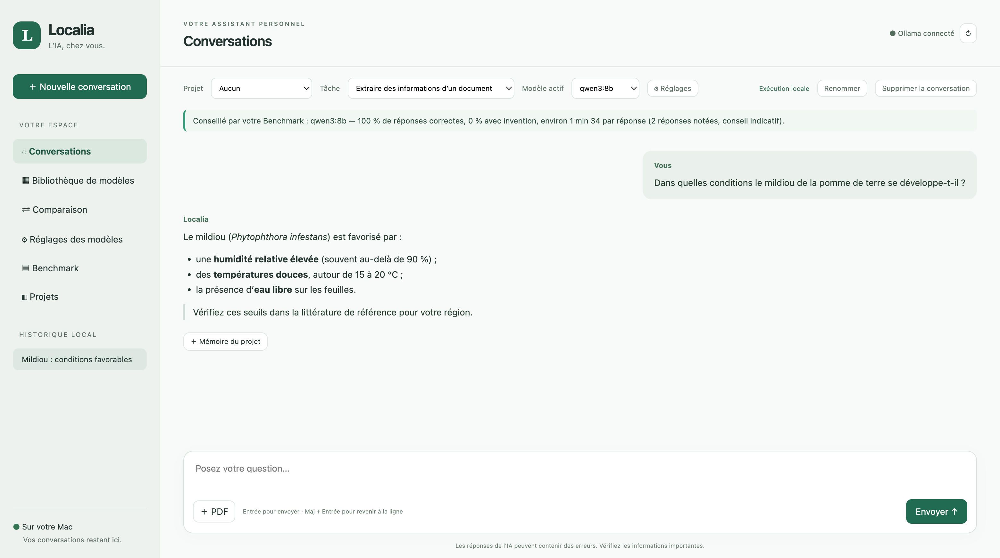
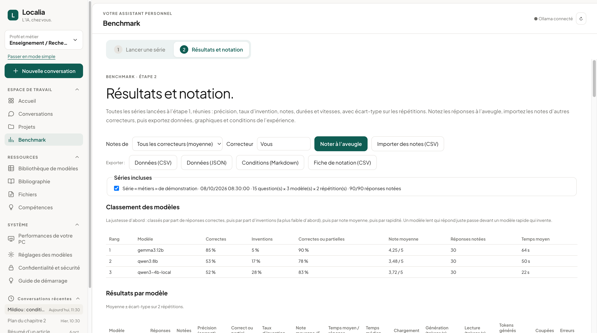
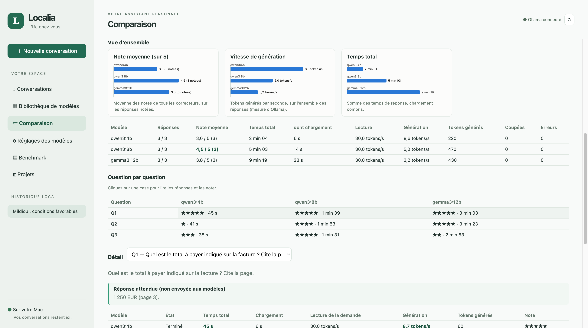
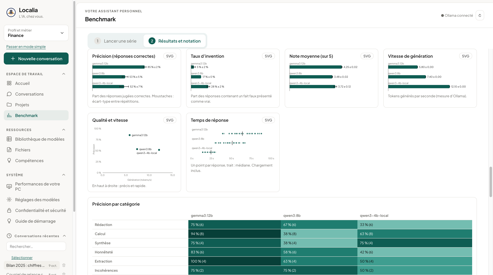

# Localia

[](https://github.com/diallo68/localia/actions/workflows/tests.yml)

*[Version française](README.fr.md)*

Localia is a desktop application for macOS and Windows for working with local language models through [Ollama](https://ollama.com), and for **benchmarking those models on your own tasks**. Everything runs on your machine: no cloud model, no telemetry.

| Chat | Benchmark |
|---|---|
|  |  |
| **Comparison of a question series** | **Benchmark charts** |
|  |  |

*Screenshots use demonstration data, not real benchmark results.*

## Features

- **Chat** with local models: streamed answers rendered as Markdown (model HTML is never executed), persistent history, rename and delete conversations.
- **PDF questions**: text is extracted locally (PDF.js); for long documents, relevant excerpts are selected and the pages sent to the model are shown.
- **Automatic checks**, without any model, under every answer: calculations recomputed, impossible page references, quotations not found in the document, numbers absent from it; PDFs containing instructions addressed to an AI are flagged on import.
- **Research assistant**: a task menu selects the model recommended by your Benchmark and adds a task instruction; project memory sends your own notes to the model as context.
- **Files, with your consent**: the model proposes a plan (sort, rename, create folders or a note) in a folder you authorized; Localia checks each action, you tick what to apply; nothing is overwritten or permanently deleted, every operation can be undone.
- **Optional encryption** of all Localia data on disk (AES-256-GCM, key in the macOS Keychain, recovery key).
- **Zotero** (local, read-only): search your library, compare an article's references with it, ask questions about an item's PDF.
- **Literature watch and scheduled series**: new articles on your topics (OpenAlex, optional), benchmark series started at a set time with the Mac kept awake.
- **Skills**: reusable Markdown instructions, chosen in the Task menu or called with `/name` at the start of a message; step-by-step paths for raw data, articles, theses and app development.
- **Data files**: attach instructions, code or a CSV to a conversation; tables are summarized (columns, types, missing values, ranges) instead of being sent in full; you run the generated code yourself.
- **Bibliography**: author citations (“Name [n]”) checked offline against the article's reference list; optionally (off by default, the only feature that uses the Internet) reference existence checked with Crossref and article search with OpenAlex.
- **Per-model settings**: temperature, context size, maximum answer length, top P, top K, repeat penalty, seed, CPU threads, keep-alive, thinking mode, permanent system prompt. Empty fields keep the model's own Modelfile values.
- **Comparison**: send one question, or a series of questions (with an optional PDF), to several models; each model answers every question in turn, then is unloaded. Series can be repeated 1–5 times, paused and resumed.
- **Benchmark**, designed for publishable results:
  - per model: accuracy, “correct or partial” rate, invention rate, mean score, mean and median time, load time, generation and prompt speed (Ollama measurements), with mean ± standard deviation across repetitions;
  - accuracy per question category (heat map), stability across repetitions, inter-rater agreement (Cohen's kappa);
  - blind grading (random order, model name hidden), import of grades from other graders (CSV);
  - exports: raw data (CSV, JSON), charts (standalone SVG), experiment conditions (Markdown: machine, Ollama version, model digests and quantization, settings used, exact messages sent).

## Requirements

- macOS on Apple Silicon or Intel, or Windows 10/11 (64-bit);
- [Ollama](https://ollama.com) with at least one local model (Localia looks for it in the usual places: `/usr/local/bin`, `/opt/homebrew/bin` or the Ollama application on macOS, `%LOCALAPPDATA%\Programs\Ollama` on Windows; `OLLAMA_PATH` overrides);
- to build from source: [Node.js](https://nodejs.org) 20 or later.

## Run from source

```sh
npm install
npm start
```

Build the application for local use:

```sh
npm run package            # Mac Intel        → dist/mac/Localia.app
npm run package:mac-arm64  # Mac Apple Silicon → dist/mac-arm64/Localia.app
npm run package:win        # Windows          → dist/win-unpacked/Localia.exe
npm run dist:mac           # .dmg and .zip for both Mac processors
npm run dist:win           # Windows installer and .zip
```

Mac builds are signed *ad hoc* (required on Apple Silicon), not with an Apple developer certificate.

## Tests

```sh
npm test                 # unit tests (no Electron, no Ollama)
npm run test:features    # desktop app, Ollama simulated
npm run test:pdf         # desktop app, real PDF import, simulated answers and services
npm run test:encryption  # data encryption, simulated key store
npm run test:desktop     # desktop app, requires a running Ollama with one model
```

The GitHub workflow runs these tests and builds the application on macOS Apple Silicon, macOS Intel and Windows.

## Question series format

A series is a `.txt` or `.md` file. Questions are separated by a line containing only `---`. Each question may start with `## Title` and contain a `Category: …` line (or `Catégorie : …`) and an `Expected: …` section (or `Attendu : …`, until the end of the block). The category and the expected answer are **never sent to the models**. See [`benchmark/`](benchmark/) for examples.

## Data and privacy

- Models run through Ollama on `127.0.0.1:11434`; cloud models are excluded.
- Zotero is read through its local API (`127.0.0.1:23119`); an item is written to Zotero only when you click “Add to Zotero”.
- **Online services are off by default.** Once allowed in the Bibliography tab, only the text of a search, a reference to check or a watched topic is sent, and only to `api.openalex.org` and `api.crossref.org`. Documents, notes and conversations never leave the computer.
- Data (history, settings, comparisons, projects, extracted PDF text, action log, literature watch) is stored in Electron's user data folder. It can be **encrypted** (AES-256-GCM, key protected by the macOS Keychain or Windows data protection, exportable recovery key).
- File actions only touch folders you authorize, after you approve each action; nothing is overwritten or permanently deleted.
- The Electron renderer is sandboxed and isolated, with no Node access and no remote content.

## Limitations

- On computers without a supported GPU, models run on the CPU: expect a few tokens per second for 4–12B models.
- Long PDFs are sent as keyword-selected excerpts (10,000 characters), not in full.
- The application is not notarized by Apple nor signed for Windows: the system warns on first launch (macOS: right-click → Open; Windows: “More info” → “Run anyway”).
- Scheduled tasks (literature watch, scheduled series) run only while Localia is open.
- Grades are human (or external) judgements: the benchmark computes statistics, it does not grade answers automatically.

## License and citation

Apache License 2.0, see [LICENSE](LICENSE). Bundled third-party code: [markdown-it](https://github.com/markdown-it/markdown-it) (MIT, `src/vendor/`).
If you use Localia in research, please cite it using [CITATION.cff](CITATION.cff). Version history: [RELEASE_NOTES.md](RELEASE_NOTES.md).

